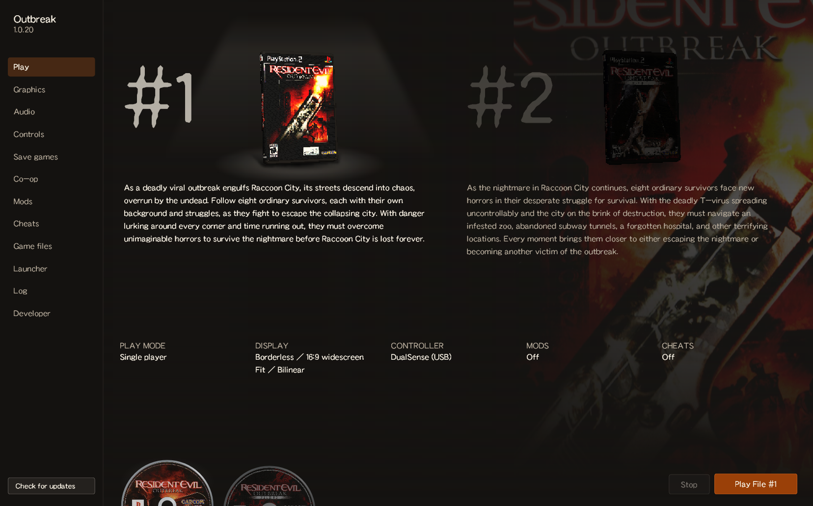
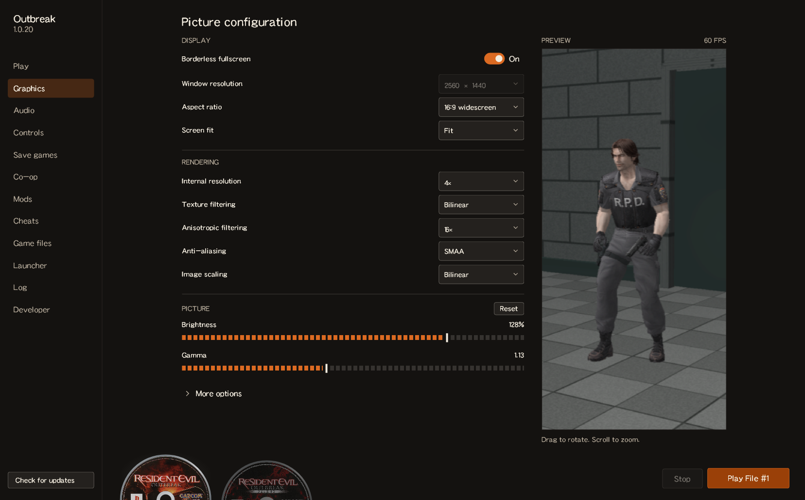
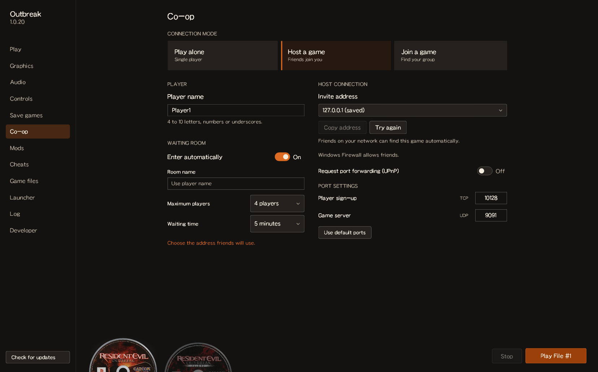

# RE: Outbreak

A native Windows port of Resident Evil Outbreak (PS2). The game code is statically
recompiled from your own disc and runs on a PS2 compatibility runtime, so there is no
emulator involved. Outbreak File #1 is playable from start to finish, including online
co-op. File #2 works too, but is still experimental.

**[Download the latest release](https://github.com/Ninjacornix/reo/releases/latest)** ·
[Requirements](REQUIREMENTS.md) · [Report a problem](https://github.com/Ninjacornix/reo/issues)

This is an unofficial fan project. You need your own copy of the game; no game files or
game code are included in the download.

## What you get

- **File #1**, playable start to finish: menus, scenarios, cutscenes, movies, audio and saves.
- **File #2** (experimental), with its own import, build and saves.
- **Online co-op** for up to four players. One player hosts from the launcher and the
  others join by address or on the local network. No accounts or registration.
- **Graphics options**: up to 4× internal resolution, 16:9, 21:9 and 32:9 display modes,
  FXAA/SMAA, texture filtering, brightness and gamma.
- **Audio**: separate master, music, effects, voice and interface volume, plus optional
  spoken subtitles.
- **Controllers**: DualSense, DualShock 4, Xbox controllers and keyboard, all remappable.
- **Mods and cheats**: a seeded Randomizer for both games, asset replacement packs and
  built-in cheats. See [making mods](docs/MODDING.md).

## Getting started

1. Download `RE-Outbreak-<version>-Windows-x64.zip` from the
   [latest release](https://github.com/Ninjacornix/reo/releases/latest), extract it to a
   new folder and run `Outbreak.Launcher.exe`. Nothing else needs to be installed.
2. Click **Choose ISO** and pick your disc image. Supported discs:
   - File #1: NTSC-U v2.00 (SLUS-20765)
   - File #2: NTSC-U v1.05 (SLUS-20984)
3. Click **Build game**. The launcher imports the disc, downloads a compiler and builds
   the game on your PC. This happens once, needs an internet connection and about 10 GB
   of free space, and can take an hour or more.
4. Click **Play**.

Later launches start straight away. Keep the ISO where it is, since the game reads from
it. Your graphics driver needs OpenGL 3.3; Vulkan is used for GPU rendering when
available. PAL and Japanese discs are not supported.

## Co-op

Open **Co-op** and choose **Host a game** or **Join a game**. The host shares an address
with friends, who either paste it in or pick the game from the local network list. The
first time you host, the launcher sets up a small server (it downloads Python if needed);
after that it starts immediately.

Over the internet the host has to be reachable. A VPN like Tailscale or ZeroTier is the
easiest option. Otherwise forward these ports to the host; the launcher can try to do this
for you with UPnP.

| Port | Used for |
| --- | --- |
| UDP 9090 | Login |
| TCP 10127 | Game app server |
| UDP 9091 | Game server (changeable) |
| TCP 10128 | Player sign-up (changeable) |
| UDP 10129 | Finding the host and sharing session settings (changeable) |

Players who join can see the host's IP address. Connections behind carrier-grade NAT
usually need a VPN. More detail is in the [server setup](network/server/SETUP.md) and
[networking notes](docs/NETWORKING.md).

## Where your data lives

Settings, imported discs, builds, memory cards, mods and logs are kept in a `data`
folder next to the launcher, so the whole thing can be moved or backed up as one
folder. To keep them somewhere else, use **Game files → Storage → Change folder**.
Updates keep your data.

## Status

File #1 is fully playable on Windows. Some rooms are CPU-heavy, and performance there
depends on your processor. File #2 is experimental: opening rooms, pickups and combat have
been tested, but no scenario has been verified start to finish yet. A macOS build exists in the
source tree ([notes](docs/MACOS.md)) but there is no Mac download yet. Linux support is in
progress.

## Building from source

See [building on Windows](docs/BUILDING.md), [developer tools](tools/README.md) and
[contributing](CONTRIBUTING.md). The repository is laid out as follows:

| Directory | Contents |
| --- | --- |
| `launcher/` | The launcher (Avalonia/.NET) and input adapter |
| `recomp/` | Recompilation configuration and game-specific overrides |
| `runtime/` | PS2 compatibility runtime pieces |
| `tools/` | Build, extraction, graphics backend and test tools |
| `network/` | Co-op networking and the bundled openSNAP server |
| `third_party/` | The pinned PS2Recomp submodule and its patches |

## License

This fork's own code is GPL-3.0-only. Upstream and third-party components keep their
licenses; see [LICENSE](LICENSE) and [NOTICE.md](NOTICE.md).

Resident Evil and Outbreak are trademarks of their respective owners. This project is not
affiliated with or endorsed by Capcom or Sony.
