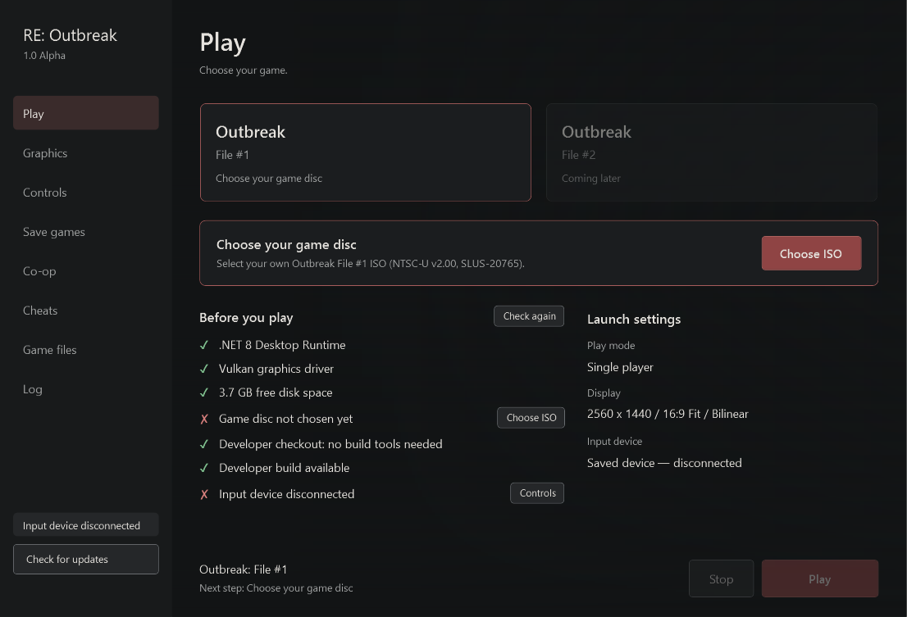
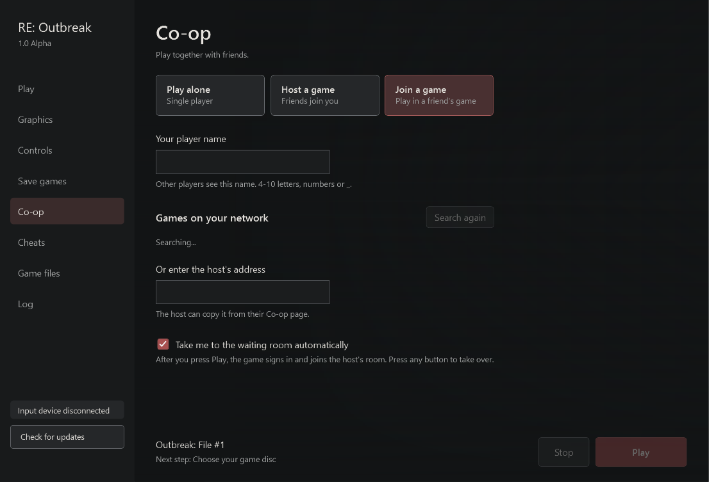

# RE: Outbreak — Resident Evil Outbreak Native PC Port

**Resident Evil Outbreak (PS2, *Biohazard Outbreak*) running natively on PC**, built with
static recompilation and a PS2 compatibility runtime — not an emulator. Play **Outbreak File #1**
from start to finish, with **online co-op** through openSNAP, a **randomizer**, **cheats**,
**controller support** and modern **video settings** up to 4K.

**Latest release: v1.0.19** | [Download for Windows](https://github.com/Ninjacornix/reo/releases/latest) | [Requirements](REQUIREMENTS.md) | [All releases](https://github.com/Ninjacornix/reo/releases)

This is an unofficial fan project. You must provide your own legally obtained game data. Game files and generated game code are not included.

## Features

- **Outbreak File #1 is fully playable** — menus, scenarios, cutscenes, movies, audio and saves, on Windows x64.
- **Online co-op (up to 4 players)** through the bundled [openSNAP](https://github.com/GrenderG/openSNAP) server: host from the launcher, friends join by address or LAN discovery. No registration, no external account.
- **Mods — Randomizer:** seeded weapon, ammunition, item and enemy-spawn randomization, shared from the host to every co-op player. [Create your own mod](docs/MODDING.md).
- **Cheats:** health, infection, ammunition and progression unlocks, plus a supported subset of PCSX2 `.pnach` cheats.
- **Controller support:** DualSense (light bar and rumble), Xbox / XInput controllers and keyboard, with full remapping.
- **Video settings:** HD, Full HD, 2K and 4K output, 2× / 4× internal resolution, 16:9 or 4:3, FXAA / SMAA anti-aliasing, anisotropic and linear texture filtering, brightness and gamma, borderless fullscreen and a performance counter.
- **Audio mixer:** separate master, music, effects, voice and menu volume.
- **One-click launcher:** checks your ISO, builds the game locally, manages memory cards, logs and updates.

## Get started

1. Install the [.NET 8 Desktop Runtime (x64)](https://dotnet.microsoft.com/en-us/download/dotnet/8.0) if you don't have it, and keep your graphics driver current (Vulkan is required).
2. Download **RE-Outbreak-v1.0.19-Windows-x64.zip** from [Releases](https://github.com/Ninjacornix/reo/releases), extract it into a new folder and open `Outbreak.Launcher.exe`.
3. The **Play** page tells you the next step. Click **Choose ISO** and pick your own **Outbreak File #1 NTSC-U v2.00 ISO (SLUS-20765)**. The launcher checks it and shows a green ✓ when it is supported.
4. Click **Build game**. This one-time setup imports the disc, prepares the build tools (about 173 MB, reused if the exact compiler is already installed) and compiles the game. It needs Internet and about 10 GB of free space, and can take over an hour. Progress stays visible at the bottom of every page.
5. Click **Play**.

The Play page's **Before you play** checklist shows what is ready (✓) and what is
missing (✗), with a button for each fix: **Get driver** opens your graphics card
maker's driver page, **Free up space** opens Windows storage settings, **Choose ISO**
picks your disc. .NET itself must be installed before the launcher can open;
Windows offers the download link if it is missing.

Later launches reuse the finished build. After a build, the launcher deletes its
temporary generated sources and keeps only a compile cache (about 1.2 GB) so future
updates rebuild only what changed. **Remove game** in **Game files** deletes the
imported disc data, the built game and that cache; your ISO stays, and saves and
build tools are only removed if you tick those options. No compiler installation, environment variable or terminal command is needed. Keep the ISO available; the game reads it directly.

Already compiled the game with a compatible launcher? In **Game files**, click **Use existing build** and choose `reo_recomp.exe` from that build folder. Keep the folder complete (`local-build.json`, DLLs and the `reo-gpu-present` shaders). Your ISO is still required.

## Status

- **Outbreak: File #1:** fully playable on Windows. Performance can still vary in CPU-heavy rooms.
- **Outbreak: File #2:** a placeholder in the launcher; not playable yet (port in progress).
- **Launcher:** guided first-run setup, ISO check before import, local build with cached reuse, display and filtering options, controller remapping, memory cards, cheats, logs, co-op hosting/joining and GitHub release updates.
- **Online co-op:** working through openSNAP; see below for what is verified and known issues.
- **Mods:** enable **Randomizer** for File #1 to randomize weapons, ammunition, common items and enemy spawns from separate seeded pools. Keys and starting equipment stay fixed; scripted enemies retain their original family. See [Creating a mod](docs/MODDING.md). **Cheats:** built-in health, infection, ammunition and progression-unlock options plus a supported subset of PCSX2 data cheats.

GPU rendering is implemented through paraLLEl-GS. VU execution and other PS2 behavior still use compatibility paths; this is not a claim that all game graphics work has moved to the GPU or that original timing is fully preserved.

The development build offers named window resolutions: **Native (512 × 448)**,
**HD (1280 × 720)**, **FHD (1920 × 1080)**, **QHD / 2K (2560 × 1440)** and
**4K (3840 × 2160)**. Existing window sizes remain available. Windows may limit
window sizes larger than the desktop; borderless fullscreen uses the desktop
resolution. **Internal resolution** separately chooses Native,
**2× (1024 × 896)** or **4× (2048 × 1792)** scene rendering before output scaling;
higher settings increase GPU load. The 4× option requires GPU sampling support;
unsupported devices report an error instead of silently substituting 2×.

The development renderer prepares the selected resolution's shaders before
gameplay and reuses its pipeline cache on subsequent launches. The launcher
shows preparation progress; a first run or a driver cache reset can take longer.
Compiler work finishes before gameplay starts. On Windows, the game requests
precise timers and opts out of process power throttling while running, restoring
the previous policy on shutdown. These changes reduce compilation and scheduling
hitches; they do not guarantee a constant update rate in CPU-heavy rooms.

Only **File #1 NTSC-U v2.00 (SLUS-20765)** is supported. Before extraction, the
launcher checks SYSTEM.CNF's boot executable, identifies known game/region serials
and verifies the executable SHA-256. PAL, Japanese, File #2, unknown games and
other/modified executable revisions get a specific error beside the ISO controls.
The ISO filename and SYSTEM.CNF's VER field do not establish the game revision.

v1.0.16 ships updated Randomizer and cheat runtime files, so the game is built
once more after updating. Runtime headers changed, so this update recompiles all
units. Later updates can reuse the compile cache where inputs are unchanged. Generation and compilation were also made faster in v1.0.11 without
changing compiler optimization; see the [measured results](docs/COMPILATION_PERFORMANCE.md).

Report problems on the [issue tracker](https://github.com/Ninjacornix/reo/issues). The previous v1.0.0 game-binary package remains withdrawn.

For development builds, see [Building on Windows](docs/BUILDING.md). Existing
local executables and generated sources are preserved for development and are
not public release assets.
Maintainers can follow [prerelease preparation](docs/PRERELEASE.md) for the
repository and package requirements. Native Linux support is in development;
no playable Linux package is currently available.

## Online co-op

Open **Co-op**, pick **Host a game** or **Join a game**, and enter a player name.
There is no registration or password: the launcher creates the account on the
host's server for you.

- **Host a game** opens your game for friends right away. Choose the address they
  should use (home network, VPN or internet) and click **Copy address**. The first
  time, the launcher prepares the hosting server: it uses an installed Python 3.12
  if you have one, otherwise it downloads a private copy, then installs the server
  packages into Local AppData. Later starts reuse it.
- **Join a game** lists games hosted on your network, or you can type the host's
  address.
- With **Take me to the waiting room automatically** (on by default), pressing
  **Play** signs in and brings you to the host's room. The host opens a room for
  four players; friends join it. Press any button to take over at any point. The
  host chooses **START SCENARIO**.

Playing over the internet needs the host to be reachable. The easiest way is a VPN
such as Tailscale or ZeroTier. Otherwise forward these ports to the host (the
launcher can ask your router through UPnP):

| Port | Use | Can it change? |
| --- | --- | --- |
| UDP 9090 | Login | No, built into the game |
| TCP 10127 | Game app server | No, built into the game |
| UDP 9091 | Game server | Yes, under **Ports** |
| TCP 10128 | Player sign-up (was TCP 80 before v1.0.12) | Yes, under **Ports** |
| UDP 10129 | Finding the host and sharing session settings | Yes |

If a port is busy, the launcher names the program using it. Internet play cannot
always work behind carrier-grade NAT without a VPN. Hosts' IP addresses are visible
to the players who join them.

What has been checked: hosting, automatic sign-up, the native credential
handshake, host-to-guest randomizer settings, and two local native clients playing
in the same network room. Movement, pickup ownership, removal of collected items,
duplicate-pickup prevention and ammunition changes were observed on both clients.
Enemy plans now use a canonical spawn order; scripted enemy reconstruction also
preserves the same maximum health on both clients. Health and actions can still
arrive late, especially during grabs. Later rooms,
mixed-species combat and reconnects remain unverified on the local test setup.

A two-player internet session (2026-10-25) completed a full scenario on both clients.
Players occasionally saw enemies missing or in different positions on one screen;
this desync is being investigated. See [server setup](network/server/SETUP.md) for
advanced overrides and [networking notes](docs/NETWORKING.md) for details.

### Developer page (next release)

The launcher's **Developer** page turns on diagnostic recordings, saved in each game's
session folder. Leave them off for normal play.

| Toggle | Setting | Records |
| --- | --- | --- |
| Packet timing | `REO_COOP_TRACE_FILE` | Every co-op packet's time, direction, size and header (`coop-trace.jsonl`); full payloads, including login, are removed when the game closes |
| Network transport log | `REO_NET_TRACE` | Socket calls and results in `stderr.log` |
| SN@P packet log | `REO_SNAP_TRACE` | The first 64 game protocol packets in `stderr.log` |
| Frame timing | `REO_FRAME_PACING_FILE` | Per-frame timing for about 9 minutes (`frames.csv`) |
| Game clock and player position | `REO_GAME_CLOCK_LOG` | File #1 game clock, room and player position for 10 minutes (`clock.csv`) |

## Source layout

| Directory | Purpose |
| --- | --- |
| `launcher/` | Windows launcher and input adapter |
| `recomp/` | Recompilation configuration and game-specific overrides |
| `runtime/`, `src/` | Original runtime/scaffold components |
| `tools/parallel_gs_backend/` | Graphics backend and movie/geometry integration |
| `tools/` | Extraction, generation, diagnostics and regression checks |
| `third_party/` | Pinned PS2Recomp submodule and local dependency patches |
| `game/`, `media/`, `network/` | Format, media and network components at varying implementation stages |

Generated sources, captures, saves, build outputs and private handoffs remain local. See [developer tools](tools/README.md) and [CONTRIBUTING.md](CONTRIBUTING.md).

## License

This fork's original contributions are GPL-3.0-only. Inherited upstream and third-party components retain their licenses and attribution; see [LICENSE](LICENSE) and [NOTICE.md](NOTICE.md).

Resident Evil and Outbreak are trademarks of their respective owners. This project is not affiliated with or endorsed by Capcom or Sony.

---

*Keywords: Resident Evil Outbreak PC, Biohazard Outbreak PC port, RE Outbreak Windows, PS2
static recompilation, PS2Recomp, Resident Evil Outbreak online co-op, openSNAP, Outbreak
randomizer, Outbreak File 1 PC, native PS2 port.*
